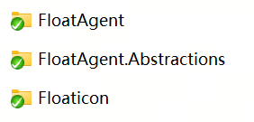

# Floaticon · 桌面悬浮 AI 助手

[English](README.en.md) | 简体中文

[](https://github.com/jackhuclan/wpf-float-agent/pkgs)
[](https://github.com/jackhuclan/wpf-float-agent/actions/workflows/ci.yml)
[](https://github.com/jackhuclan/wpf-float-agent/actions/workflows/publish-nuget.yml)
[](https://github.com/jackhuclan/wpf-float-agent/blob/main/LICENSE)

一个常驻 Windows 桌面右下角的轻量 AI 入口：一颗可拖拽的悬浮球，点击即弹出流式对话窗，内置 Markdown 渲染、Token 统计、技能（Skills）与工具（Tools）体系，模型供应商可配置。

基于 **.NET 10 WPF** 与 **Microsoft Agent Framework（MAF）** 构建，界面层零第三方 UI 框架依赖（全部自绘）。

```
┌──────────────┐   点击    ┌─────────────────────────────┐
│  悬浮球 60px  │ ───────▶ │  AI 助手            ⚙    ✕  │
│   可拖拽     │ ◀─────── │ ─────────────────────────── │
└──────────────┘   收起    │  消息区（Markdown 流式渲染）  │
                            │ ─────────────────────────── │
                            │  输入框                   ➤  │
                            └─────────────────────────────┘
```

## 功能特性

| 能力 | 说明 |
| --- | --- |
| 悬浮球常驻 | 72×72 无边框透明窗口，不占任务栏；拖拽移动，位移 ≤4 DIP 判定为点击 |
| 流式对话 | 逐 token 推送，首块到达即切换正文；生成中可随时停止 |
| Markdown 渲染 | 标题、加粗、代码块、引用、列表；Compact 紧凑排版（正文 12px） |
| 消息工具栏 | 每条 AI 回复下方显示 复制按钮 / `◇ 共消耗 N tokens` / `⚡ 模型名`（工具调用多次往返时用量累加） |
| 用户消息悬浮操作行 | 鼠标悬浮用户气泡时，气泡下方靠右露出 `11:25` 时间（跨天显示 `10月24日 09:50`）与复制按钮；悬浮判定覆盖整条消息行，指针移向按钮途中不会消失，点击即复制原文 |
| 模型配置 | 三字段表单 + 实时必填校验 + **测试连接**（明确区分成功 / 鉴权失败 / 不可达）；保存即生效，无需重启 |
| 技能系统 | `skills/` 目录下的 `SKILL.md` 自动加载，模型按需 `load_skill`（渐进式披露） |
| 工具系统 | C# 函数经 `IAIToolService` 注册为 AIFunction，由 Agent 自动调用（`get_weather` / `run_long_task` / `run_container_code`） |
| 滚动体验 | 6px 细滚动条、像素滚动、滚轮 170ms ease-out 缓动、流式期间智能跟随底部 |
| 工具进度反馈 | 长耗时工具执行期间实时上报进度（如 `⚡ run_long_task 执行中… 60 / 120 秒`），显示在“正在输入”气泡下方，不再干等 |
| 会话自动保存 | 每次新对话自动以会话 guid 命名，整会话写入运行目录 `sessions/<guid>.json`（原子覆盖写，含消息角色 / 正文 / 时间 / token 用量 / 模型名）；聊天窗标题栏「＋」一键开新会话（新 guid 新文件） |
| 多屏适配 | PerMonitorV2 DPI 感知，弹窗位置夹取到当前工作区内 |

## 技术架构

三工程拆分，依赖方向单向不可逆：



```
Floaticon（WinExe 启动壳）
  │  只做装配：Host 构建 → DI 注册 → Start → 显示悬浮球
  ▼
FloatAgent（业务类库，WPF）
  │  Models / Services / Tools / ViewModels / Views / skills
  ▼
FloatAgent.Abstractions（接口类库）
     IAIToolService（AddTool / AsTools）
```

**关键设计**

- **启动方式**：`Host.CreateApplicationBuilder` 构建通用主机，退出时 `StopAsync + Dispose` 释放资源。
- **类库不反向依赖启动工程**：类库内视图需要解析瞬时服务时通过 `ServiceLocator.Services`（由 `App` 在 Host 构建后赋值）。
- **配置即生效**：`AgentChatService` 每次请求都按 `IConfigService.Current` 重建 Agent，保存配置后下一条消息即使用新模型。
- **技能与工具的扩展点**：新增技能只需加目录；新增工具只需实现 `AIFunction` 并注册，均不改动聊天核心链路。

### 请求链路

```
ChatViewModel
  └─ IChatService.StreamReplyAsync(history)
       └─ AgentChatService
            ├─ 按当前配置创建 OpenAIClient → ChatClient → AsAIAgent
            ├─ ChatOptions.Instructions  = SystemPrompt
            ├─ ChatOptions.Tools         = IAIToolService.AsTools()
            └─ AIContextProviders        = AgentSkillsProvider（skills 目录）
                 │
                 ▼  MAF RunStreamingAsync
            StreamChunk(Text / Usage) ──▶ 气泡增量渲染（60ms 限流）
```

## 目录结构

```
wpf-float-agent/
├─ src/Floaticon/                    # 启动壳（WinExe WPF）
│  ├─ App.xaml / App.xaml.cs     # Host 构建、DI 装配、ServiceLocator 赋值
│  ├─ app.manifest               # PerMonitorV2 DPI 感知
│  └─ Properties/AssemblyInfo.cs
├─ src/FloatAgent/                   # 业务类库
│  ├─ Models/                    # ChatTurn、TokenUsage、ModelConfig
│  ├─ Services/                  # AgentChatService、JsonConfigService、AIToolService、
│  │                             # OpenAIModelTester、SkillProviderFactory、ServiceLocator
│  ├─ Tools/                     # WeatherTool（get_weather，Open-Meteo）
│  │                             # LongRunningTool（run_long_task，2 分钟长耗时）
│  │                             # ContainerCodeTool（run_container_code，Linux 容器执行 C#/Python/JS）
│  ├─ ViewModels/                # ChatViewModel、ConfigViewModel、ChatMessage
│  ├─ Views/                     # FloatingBallWindow、ChatWindow、ConfigWindow
│  │  └─ Behaviors/              # SmoothScrollBehavior（滚轮缓动）
│  └─ skills/                    # grill-me、skill-creator、get-weather
├─ src/FloatAgent.Abstractions/      # IAIToolService、ToolProgressService
├─ src/RecipeDemo/                   # RecipeDemo 演示外壳（配方树 + 五视图 + 悬浮球）
├─ docs/                         # PRD（md + docx）
├─ output/                       # PRD 生成链路中间产物
├─ Directory.Build.props         # 全解决方案共享元数据（版本/作者/项目地址/描述）
├─ Directory.Packages.props      # NuGet 中央包版本管理
├─ build.cmd / build.ps1         # 一键 Release 构建 + NuGet 打包（产物 → release\ / artifacts\）
├─ AGENTS.md / .editorconfig     # 项目规范与代码风格
└─ Floaticon.slnx
```

## 环境要求

- Windows 10 / 11
- [.NET SDK 10.0](https://dotnet.microsoft.com/download)（开发时使用 10.0.402）
- 一个 OpenAI 兼容的模型端点（默认适配 DeepSeek，也支持本地 Ollama 的 qwen 系列）

## 快速开始

```bash
git clone https://github.com/jackhuclan/wpf-float-agent.git
cd wpf-float-agent

dotnet build Floaticon.slnx

# 运行（也可直接双击 src/Floaticon/bin/Debug/net10.0-windows/Floaticon.exe）
dotnet run --project src/Floaticon
```

启动后桌面右下角出现悬浮球，**单击**弹出聊天窗，**右键**可打开聊天或退出。

### 构建与打包

仓库根目录提供一键构建脚本（`build.cmd` 是 `build.ps1` 的命令行入口，参数原样透传）：

```bat
:: win-x64 自包含单文件发布（内含 .NET 运行时，目标机器无需安装 .NET）
:: 产物：release\Floaticon-<版本号>.exe（版本号取自 Directory.Build.props）
build.cmd

:: 打包 NuGet 包（FloatAgent、FloatAgent.Abstractions），输出到根目录 artifacts\
build.cmd -Pack

:: 带版本后缀打包（生成 FloatAgent.1.3.1-preview.nupkg）
build.cmd -Pack -VersionSuffix preview

:: 先清理 release\ / artifacts\ 再发布
build.cmd -Clean
```

> 单文件发布实质执行：`dotnet publish -c Release -r win-x64 --self-contained true -p:PublishSingleFile=true -p:IncludeNativeLibrariesForSelfExtract=true`。exe 首次启动会自解压本机库到临时目录，稍慢属正常；技能（skills）目录与 config.json 仍按"运行目录"约定放在 exe 旁边。

版本号、作者、项目地址、描述等工程元数据统一在根目录 `Directory.Build.props` 中维护（自动导入全部 .csproj），发版只改一处。

> 说明：`FloatAgent` 依赖的 MdXaml（2.0.0-pre）与 Microsoft.Agents.AI.Tools.Shell（1.25.0-preview）为预发布包，打稳定版 NuGet 包时会出现 NU5104 提示，不影响包的生成与使用。

### CI / NuGet 自动发布（GitHub Actions）

仓库内置两个工作流：

- [`.github/workflows/ci.yml`](.github/workflows/ci.yml) — **CI**：推送到 `main` 或 PR 时（纯文档提交自动跳过）执行 Restore → Release 编译 → 打包冒烟（校验两个类库包按当前版本号产出）；不推送包，仅校验。
- [`.github/workflows/publish-nuget.yml`](.github/workflows/publish-nuget.yml) — **发布**：每次推送到 `main`（或手动触发、发布 Release）时，自动打包 `FloatAgent` / `FloatAgent.Abstractions` 并发布到 **GitHub Packages**（`https://nuget.pkg.github.com/jackhuclan/index.json`）。同版本重复发布会自动跳过；且带**版本门禁**——push 的最新提交若改了代码（`src/`、`*.csproj`、props、`Floaticon.slnx`）而没升 `Directory.Build.props` 的 `<Version>`，流水线直接失败，确保每次代码更新都会发布带新版本号的包。

从 GitHub Packages 安装（需 GitHub PAT，public 包也要求认证）：

```bash
dotnet nuget add source \
  --username <GitHub 用户名> --password <PAT> --store-password-in-clear-text \
  --name github "https://nuget.pkg.github.com/jackhuclan/index.json"

dotnet add package FloatAgent --source github
```

### 配置模型

API Key 只从 `config.json` 读取，**代码中不保留任何密钥**。首次启动时配置文件不存在，点开 **⚙** 后三个字段都会红框提示必填：

- **推荐**：在配置窗里填写三项 → 点「测试连接」确认可用 → 保存。应用会把配置写入 exe 所在目录的 `config.json`。
- **手动**：把 `config.example.json` 复制为 exe 同目录下的 `config.json` 并填入密钥，重启应用即可。

| 字段 | 说明 | 示例 |
| --- | --- | --- |
| API Key | 端点密钥（必填，无默认值，输入以掩码显示） | `sk-...` |
| 模型 | 下拉选择，已有配置值不在列表时会自动补入 | `deepseek-chat` |
| 接口地址 | OpenAI 兼容端点 | `https://api.deepseek.com/v1` |

配置保存为**运行目录下的 `config.json`**（启动时已把工作目录锚定到 exe 所在目录，故无论双击还是命令行启动都指向同一位置），结构见 `config.example.json`：

```json
{
  "ApiKey": "sk-...",
  "Model": "deepseek-chat",
  "Endpoint": "https://api.deepseek.com/v1"
}
```

> ⚠️ `config.json` 已列入 `.gitignore`，API Key 以明文存储，请勿提交或分享该文件；仓库里只有不含真实密钥的 `config.example.json`。配置文件缺失或损坏时会回落默认值（API Key 为空），不阻塞启动，只需重新填写。

## 扩展指南

### 新增技能

在 `src/FloatAgent/skills/` 下新建目录，放入 `SKILL.md`（YAML frontmatter + 正文指令）：

```markdown
---
name: my-skill
description: 一句话说明何时该用这个技能（模型据此决定是否加载）
---

# My Skill
具体执行步骤……
```

重新编译运行后，模型会先看到技能目录摘要，需要时自行 `load_skill` 加载全文。可选附带资源文件（`.md`/`.json`/`.yaml`/`.yml`/`.txt`），由 `read_skill_resource` 读取；出于安全考虑**不执行**技能内脚本。

### 新增工具

```csharp
public sealed class MyTool
{
    [Description("工具用途，模型据此决定何时调用")]
    public async Task<string> DoSomethingAsync(
        [Description("参数说明")] string input,
        CancellationToken cancellationToken = default) { /* ... */ }
}

// 在 src/Floaticon/App.xaml.cs 的 RegisterTools 中注册
Func<string, CancellationToken, Task<string>> fn = tool.DoSomethingAsync;
registry.AddTool(AIFunctionFactory.Create(fn, "do_something"));
```

> 用显式委托类型接收方法组，才能保留方法与参数上的 `[Description]`，模型才拿得到参数说明。

> 长耗时工具建议注入 `ToolProgressService`（DI 单例）并周期性 `Report("…")`，进度会实时显示在“正在输入”气泡下方，避免长时间零反馈。参考 `LongRunningTool` 的实现。

**包装无法修改的第三方长耗时方法**：第三方代码内部不能上报进度时，用 `PeriodicProgressService` 在等待侧代报（开始 1 次 → 每 5 秒 1 次 → 完成 1 次），第三方代码零改动：

```csharp
// App.xaml.cs 的 RegisterTools 中（progressService 从容器解析 ToolProgressService）
var periodic = PeriodicProgressService.Create(
    progressService, "thirdparty_long_run_task", ThirdPartyLib.LongRunAsync);

// RunAsync 只剩 CancellationToken 一个参数；用方法组注册，别用 lambda（会丢失取消接线）
Func<CancellationToken, Task<string>> run = periodic.RunAsync;
registry.AddTool(AIFunctionFactory.Create(run, "thirdparty_long_run_task", "第三方的长时间运行任务"));
```

构造函数为私有，统一通过 `Create` 工厂方法创建；支持四种第三方形态：`Func<CancellationToken, Task>`、`Func<Task>`、`Action`（线程池执行）、`Func<CancellationToken, Task<string>>`（返回值附在完成汇报里）。第三方抛异常会转为可读的失败结果文本，点“停止”仍可在周期间隔内取消。

## 内置技能与工具

| 名称 | 类型 | 用途 |
| --- | --- | --- |
| `grill-me` | 技能 | 方案拷问：把模糊方案视为决策树，按「前沿」逐轮编号提问，前沿清空后输出共识摘要 |
| `skill-creator` | 技能 | 技能创作方法论：创建、改进、评测技能 |
| `get-weather` | 技能 | 天气查询规约：强制走工具取数、禁止编造、多城市多次调用、未指明城市先反问 |
| `get_weather` | 工具 | Open-Meteo 实时天气 + 未来三天预报（无需 API Key），WMO 代码映射中文描述 |
| `run_long_task` | 工具 | 长耗时任务（固定 2 分钟）：逐秒切片等待、支持中途取消、每 5 秒上报执行进度，返回任务名 / 起止时间 / 实际耗时；用于验证工具长时间占用时 Agent 仍能续答 |
| `thirdparty_long_run_task` | 工具 | 模拟第三方长任务（约 15 秒，内部无法上报进度）：由 `PeriodicProgressService` 在等待侧周期上报进度，返回执行结果；验证第三方方法的进度包装链路 |
| `run_container_code` | 工具 | 基于 `Microsoft.Agents.AI.Tools.Shell` 的 `DockerShellExecutor`，在一次性 Linux 容器中执行 C# / Python / JavaScript 代码（宿主机无需运行时）：脚本支持路径或内联代码、base64 写入后执行、网络隔离 + 1 GiB 内存上限 + 180 秒超时、每 5 秒上报进度；C# 在容器内生成离线可 restore 的迷你工程编译执行（不访问网络）；首次运行需拉取镜像 |

## RecipeDemo 演示外壳

`src/RecipeDemo` 是一个独立运行的演示工程（窗口标题 RecipeWindow），用于预演产线配方管理界面：

- **左侧配方树**：顶部搜索框按名称过滤；"Recipes" 根节点旁的 Collapse 折叠全部；右缘小蓝条收起/展开面板。
- **右侧五个视图**（各自独立 UserControl + ViewModel）：Summary / Wafer Map / Alignment / Tests / Recipe-Run Parameters，顶部标签条切换。
- 点击配方树中的配方，**Summary 显示「当前选择的配方是：***」**；Wafer Map 初始只有「Create Wafer Map」按钮，点击后生成晶圆映射；Alignment 为 Edge / Coarse / Fine 箭头式子标签（Caculate、Create Template + Run）+ 右下角 Save。
- **AI 工具与技能打通**：`skills/alignment/` 内置配方拉平标准作业流程技能（选择配方 → 圆心定位 → 粗定位 → 精定位 → Updating LLC → 保存，含人工确认卡点）；对应 11 个 AI 工具在 ViewModel 中注册——`select_recipe` / `open_alignment` 在 `MainViewModel`，其余 9 个（视图切换、找圆心、创建模版、粗/精定位、define_llc、save_recipe）在 `AlignmentViewModel`，均通过注入 `IAIToolService` 调用 `AddTool` 注册，工具在后台线程调用、经 `AppHelper.DispatcherInvoke` 投递到 UI 线程改界面状态，失败分支（视图不对 / 模版未创建）按真实规则拦截。
- **工具执行日志**：所有工具调用自动写入会话内日志（时间/名称/参数/结果/耗时），模型可用内置的 `query_tool_history` 工具查证"某一步是否真的执行过"，不凭记忆断言调用历史。
- 主窗打开时同时显示 FloatAgent 的悬浮球，点击悬浮球弹出聊天窗；技能放在 `src/RecipeDemo/skills/`，构建时复制到 exe 旁。

```bash
dotnet run --project src/RecipeDemo
```

## 技术栈

| 组件 | 版本 | 用途 |
| --- | --- | --- |
| .NET / WPF | net10.0-windows | 桌面框架 |
| Microsoft.Agents.AI(.OpenAI) | 1.25.0 | Agent、技能调度、流式对话 |
| Microsoft.Extensions.AI.Abstractions | 10.10.1 | AIFunction / ChatMessage 抽象 |
| CommunityToolkit.Mvvm | 8.4.2 | ObservableObject / RelayCommand |
| MdXaml | 2.0.0-pre | Markdown → FlowDocument 渲染 |
| Microsoft.Extensions.Hosting | 10.0.12 | 通用主机与依赖注入 |

## 已知限制

- 用户消息按纯文本渲染（蓝底气泡上 Markdown 观感不佳，方案待定）。
- 长回复期间 Markdown 整篇重排有轻微开销，已用 60ms 限流缓解。
- 中文输入法下首个 Enter 用于候选上屏属预期行为，上屏后的 Enter 才发送。
- 未做单实例限制，重复启动会出现多个悬浮球。

## 更新记录

| 版本 | 日期 | 变更 |
| --- | --- | --- |
| 1.7.0 | 2026-10-27 | 拉平技能依据实际运行反馈优化：核心原则新增"事实只认两个来源 / 被质疑先定事实不迎合 / 返回值如实引用"三条与对应反例（杜绝编造已完成、迎合式改口、凭印象转述）；新增工具执行日志：所有工具调用自动记录（时间/名称/参数/结果/耗时），内置 `query_tool_history` 工具供模型查证调用历史；新建会话时日志清空 |
| 1.6.0 | 2026-10-27 | 会话自动保存：每次新对话按会话 guid 写 `sessions/<guid>.json`（ISessionStore / JsonSessionStore，原子覆盖写，含角色 / 正文 / 时间 / token 用量 / 模型名，标题取首条用户消息）；聊天窗标题栏新增「＋」新建会话按钮，换新 guid 开新文件；用户消息发送后与每轮问答结束即落盘 |
| 1.5.0 | 2026-10-27 | RecipeDemo 打通技能与 AI 工具：内置 alignment 拉平作业流程技能（4 阶段 12 动作 + 人工确认卡点），新增 11 个工具（select_recipe / open_alignment / switch_to_edge_alignment / calculate_wafer_center / switch_to_coarse_alignment / create_recipe_template / run_coarse_align / switch_to_fine_alignment / run_fine_align / define_llc / save_recipe），由 MainViewModel / AlignmentViewModel 注入 IAIToolService 注册，后台线程调用经 Dispatcher 投递 UI 线程 |
| 1.4.0 | 2026-10-27 | 新增 RecipeDemo 演示外壳：配方树（搜索/折叠/收起）+ Summary / Wafer Map / Alignment / Tests / Recipe-Run Parameters 五视图；点击配方 Summary 显示当前配方；Wafer Map 仅 Create Wafer Map 按钮；Alignment 为 Edge/Coarse/Fine 箭头子标签 + 右下角 Save；主窗打开时显示 FloatAgent 悬浮球；含 skills 目录 |
| 1.3.2 | 2026-10-26 | publish-nuget 增加版本门禁：改代码不升版本号的推送直接失败，保证每次代码更新都发布带新版本号的 NuGet 包 |
| 1.3.1 | 2026-10-26 | 修复用户气泡悬浮操作行：悬浮判定扩到整条消息行，指针从气泡移向复制按钮（含中间 4px 间隙）时按钮不再消失，可正常点击复制；复制按钮可点区域 26×18 |
| 1.3.0 | 2026-10-24 | 版本元数据集中到 `Directory.Build.props`；新增 `run_container_code` 容器代码执行工具、`PeriodicProgressService` 工厂方法 |
| 1.2.0 | 2026-10-24 | 三工程迁入 `src/`，新增英文 README、MIT LICENSE、GitHub Actions CI 与 NuGet 自动发布 |
| 1.1.0 | 2026-10-23 | 长耗时工具与进度反馈、技能系统、工具注入、滚轮缓动与流式跟随 |

发版约定：**每次代码改动同批更新 README（中/英）、PRD、`Directory.Build.props` 版本号，并用 `build.cmd -Pack` 重新产出 `artifacts\` 下的带版本号 NuGet 包，一并提交推送**（同版本重复推送会被 publish-nuget 自动跳过，所以必须升版本号）。

## 相关文档

- [产品需求文档 PRD（V1.3，文件名沿用 v1.1）](docs/Floaticon-PRD-v1.1.md) · [docx 版（v1.0 存档）](docs/Floaticon-PRD-v1.0.docx)

## License

本项目基于 [MIT](LICENSE) 许可证开源。
