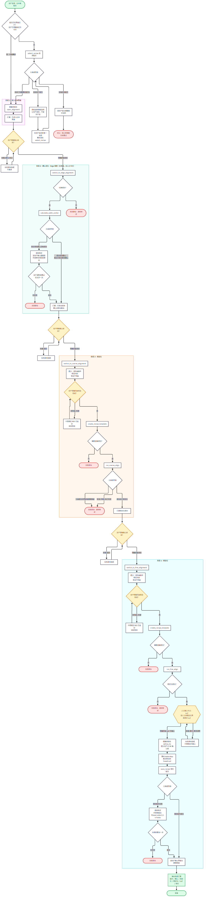
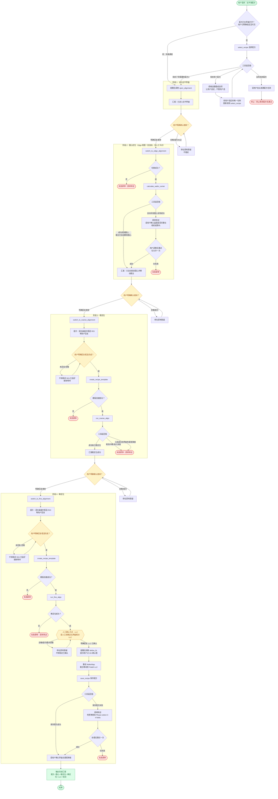

# Alignment（配方拉平）流程图

本图依据 `src/RecipeDemo/skills/alignment/SKILL.md`（技能正文，4 阶段 12 动作）整理，用于快速把握执行顺序、分支与人工卡点。技能正文为唯一事实来源，两者冲突时以 SKILL.md 为准。

## 流程图

渲染版（另有 Mermaid 源码见下节，GitHub 可直接渲染）：

### Mermaid 源码

## 图例

| 形状 / 颜色 | 含义 |
| --- | --- |
| 绿色圆角（起止、完成汇报） | 流程入口与出口 |
| 黄色菱形/六边形 | 人工卡点：必须收到用户**明确**答复才放行（含糊、提问、纠正一律视为未确认） |
| 红色节点 | 「失败即停」出口：工具报错、返回非成功、或工具报成功但界面弹报错窗（核心原则 5 / 7） |
| 白色矩形 | 单个工具调用或提示动作，一次只做一步 |

## 关键卡点一览

| 卡点 | 前置条件 | 放行条件 | 违反后果 |
| --- | --- | --- | --- |
| 阶段 1 → 2 | `open_alignment` 返回成功 | 用户明确回复继续 | 跳步、抢跑 |
| 阶段 2 → 3 | `calculate_wafer_center` 返回成功 | 用户明确回复继续 | 找圆心是唯一全自动步骤，但仍需汇报 |
| 阶段 3 ROI | 已切到 Coarse 视图 | 用户明确回复框选完成 | 未框选就执行会失败或点到错误区域 |
| 阶段 3 → 4 | `run_coarse_align` 返回成功 | 用户明确回复继续 | 粗定位未成功就精定位，结果不可信 |
| 阶段 4 ROI | 已切到 Fine 视图 | 用户明确回复框选完成 | 同上 |
| **LLC** | `run_fine_align` 返回成功 | 用户明确回复「LLC 已确认」 | 未确认即 `define_llc` 会按错误位置重绘 WaferMap 并移动载台 |
| 保存 | `define_llc` 完成 | — | 保存失败需先处理界面弹窗（如 `Please select 2-4 fields！`） |

## 与技能正文的对应关系

- 核心原则 1–4（一次一步、事前提醒、禁止跳步、确认即放行）→ 图中的 `G1`–`G5` 卡点与"停在原地答疑"回边。
- 核心原则 5（失败即停，同工具最多重试 1 次）→ 所有 `X*` 红色出口。
- 核心原则 6（不猜参数）→ 阶段 0 多配方时让用户选定、工具不可用直接终止。
- 核心原则 7（界面弹窗也是结果）→ 阶段 3 的"工具成功但界面有报错弹窗"分支。
- 核心原则 8–10（事实只认工具返回原文 / 被质疑先定事实不迎合 / 返回值必须如实引用）→ 每个 `{工具返回值}` 判定节点，以及汇报必须写在工具返回之后。

相关文件：

- 技能正文：[`src/RecipeDemo/skills/alignment/SKILL.md`](../src/RecipeDemo/skills/alignment/SKILL.md)
- 工具契约与注册：`MainViewModel`（`select_recipe` / `open_alignment`）、`AlignmentViewModel`（其余 9 个）
